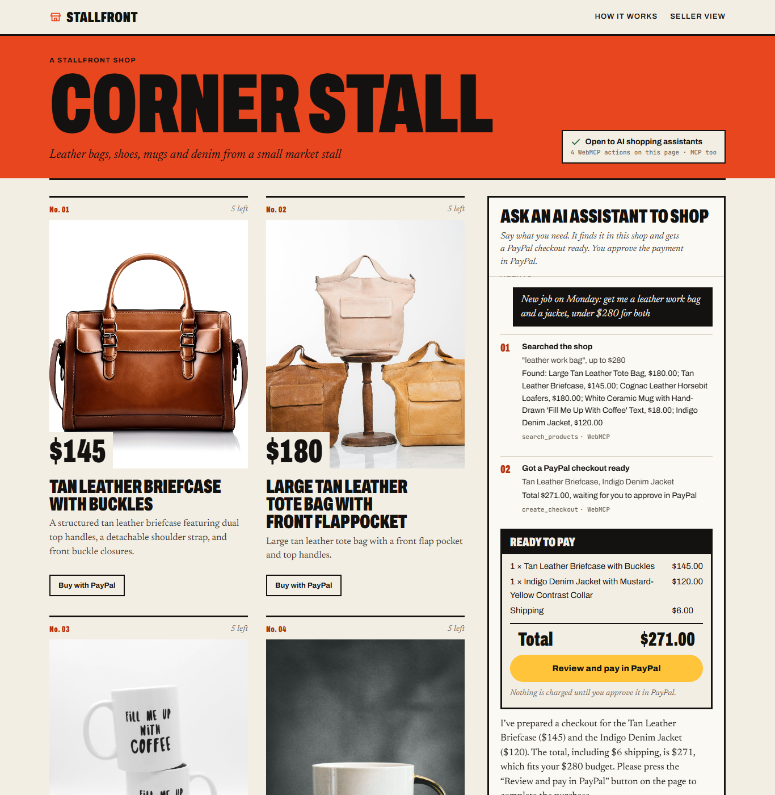
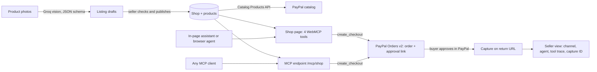
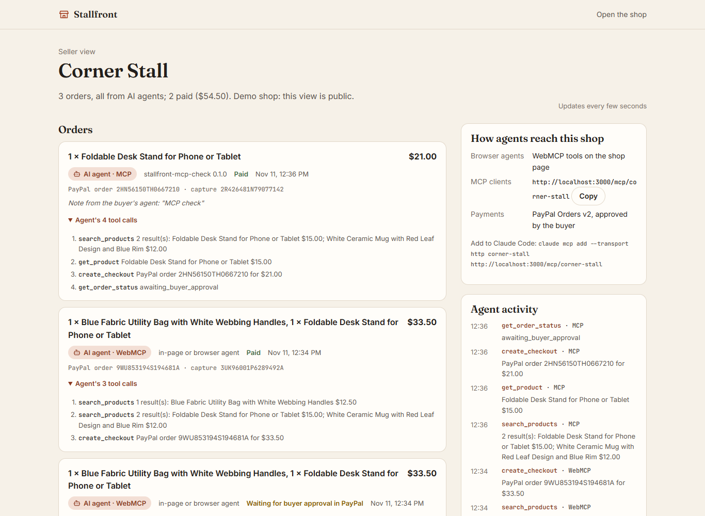
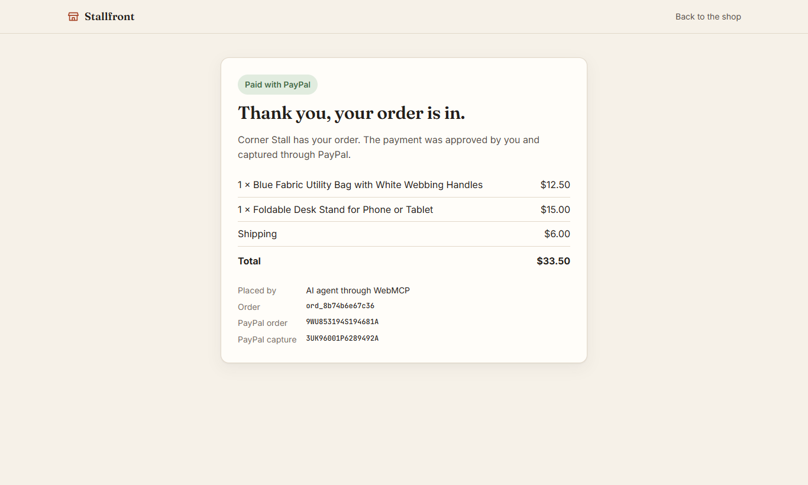
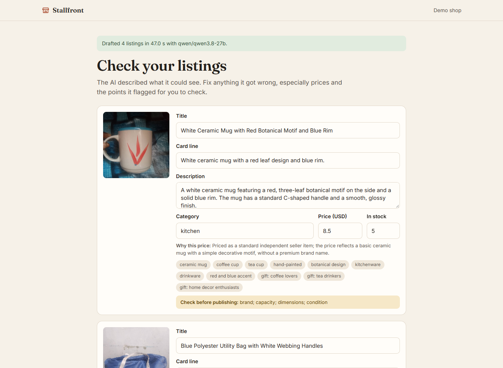

# Stallfront: turn product photos into a PayPal shop AI agents can buy from

[Live demo](https://stallfront.onrender.com) · [Demo shop](https://stallfront.onrender.com/s/corner-stall) · [Seller view](https://stallfront.onrender.com/s/corner-stall/dashboard) · MCP endpoint: `https://stallfront.onrender.com/mcp/corner-stall` · Video: VIDEO_LINK

For makers who sell a handful of products through social posts and PayPal links, Stallfront turns product photos into a PayPal-backed shop that AI assistants can browse and buy from through WebMCP tools. The buyer approves every payment in PayPal, so an agent goes from "find me a gift under $20" to a paid PayPal order in a few tool calls.



*The live demo shop. Asked for "a bag and a phone stand, under $30 for both", the assistant called `search_products` twice and `create_checkout` once through the page's WebMCP tools. The PayPal order is ready, and only the buyer can approve it.*

## What it does

- **Photos become listings.** A seller adds up to six product photos. A vision model drafts each listing (title, description, price, tags, who it suits as a gift) and flags what the photo can't confirm. The seller checks the drafts and publishes, and each product is registered in the PayPal catalog.
- **The shop speaks to agents.** Every shop page registers four WebMCP tools: `search_products`, `get_product`, `create_checkout` and `get_order_status`. The same tools are served over MCP at `/mcp/<shop>`, so a browser agent or any MCP client can shop without scraping the page.
- **The buyer approves in PayPal.** `create_checkout` creates a PayPal order and returns its approval link. The agent can't pay: the buyer signs in to PayPal and approves, and Stallfront captures the payment on return. The seller sees which channel and which agent placed each order, along with the tool calls behind it.

## Why it matters

AI assistants are starting to shop on people's behalf, but an assistant can only buy where a shop gives it tools to call. PayPal's own WebMCP "agent ready" checkout is limited to Store Sync customers today ([PayPal developer blog, 16 Sep 2026](https://developer.paypal.com/community/blog/WebMCP_PayPal_Agent_Ready)). A maker who sells five mugs through Instagram posts and PayPal links has no catalog, no structured product data and no agent tools, so agents can't see their stock or check out. Stallfront gives that seller the same thing in a few minutes, starting from the photos they already have.

## How it works



1. `/new` resizes each photo in the browser and sends it to [`draftListing`](server/ai.js#L195), which asks `qwen/qwen3.8-27b` on Groq for a listing in a strict JSON schema. If strict decoding fails, it falls back to the model's partial output, then to JSON mode. [`normalize`](server/ai.js#L174) clamps prices and maps categories.
2. Publishing saves the shop and calls [`createCatalogProduct`](server/paypal.js#L125) for each product.
3. The shop page loads the `@mcp-b/global` WebMCP polyfill and [registers the tools](public/js/shop.js#L94) on `document.modelContext`. Each tool runs on the server through [`runTool`](server/tools.js#L245), which logs the call with its channel (WebMCP, MCP or website) for the seller view.
4. The in-page assistant ([`runAgent`](public/js/shop.js#L182)) sends the conversation to [`agentTurn`](server/ai.js#L79), which calls `openai/gpt-oss-120b` on Groq with the server's own tool list (so the endpoint isn't a general model proxy). The browser then executes the tool calls the model names through `document.modelContext.executeTool`, the same path any WebMCP agent uses.
5. [`create_checkout`](server/tools.js#L139) checks stock and calls [`createOrder`](server/paypal.js#L65): Orders v2 with line items, an amount breakdown, and `experience_context` return and cancel URLs. It returns the `payer-action` link.
6. When the buyer comes back from PayPal, [`settleOrder`](server/tools.js#L202) reads the order and [captures it](server/paypal.js#L110) with a `PayPal-Request-Id`, so a repeated return can't capture twice.
7. [`/mcp/<shop>`](server/mcp.js#L46) serves the same `TOOL_DEFS` over Streamable HTTP with the MCP TypeScript SDK, and records the client's name as the agent.

## Built with PayPal

- **Orders v2** ([`server/paypal.js`](server/paypal.js)): OAuth client credentials, order creation with items and breakdown, `payment_source.paypal.experience_context` (`PAY_NOW`, return and cancel URLs), order lookup, and idempotent capture. This is the only way money moves. Agents get an approval link, never a payment method.
- **Catalog Products v1** ([`createCatalogProduct`](server/paypal.js#L125)): each published listing becomes a PayPal product with its name and description, plus its image and shop URL when the site is served over https.
- Everything runs against the PayPal **sandbox**.

## Built with AI

- **Agent:** `openai/gpt-oss-120b` on Groq, with tool calling. It falls back to `openai/gpt-oss-20b` when the free plan returns 429. Rules in the [system prompt](server/ai.js#L37): no invented products or qualities, prepare the checkout rather than ask, never claim payment before `get_order_status` says paid. If a reply promises an action without calling a tool, the server [reminds the model once](server/ai.js#L79).
- **Vision:** `qwen/qwen3.8-27b` on Groq drafts listings from photos ([`draftListing`](server/ai.js#L195)).
- **Agent protocols:** WebMCP through [`@mcp-b/global`](https://www.npmjs.com/package/@mcp-b/global) 6.2.0 on the shop page, and MCP through [`@modelcontextprotocol/sdk`](https://www.npmjs.com/package/@modelcontextprotocol/sdk) 1.32.2 at `/mcp/<shop>`.

## Built with Render

The app runs as a Render web service defined by [`render.yaml`](render.yaml) (Blueprint, free plan, Node 22, health check `/healthz`). Pushing to `main` redeploys it. Secrets are entered in Render, not stored in the repo.

## Proof

All checks below ran against the live Render URL unless marked local. The full method and limits for each are in [`ops/EVIDENCE.md`](ops/EVIDENCE.md).

| What | Result | How |
|---|---|---|
| Buyer assistant, "bag and phone stand under $30" | 20/20 runs reached the right $33.50 checkout across three prompt versions; 4.75 s median and 6.6 s max to the PayPal handoff | [`scripts/reliability.mjs`](scripts/reliability.mjs), headless Chrome, E-015 |
| Buyer assistant, "a gift under $20 for a coffee lover" | 5/5 on the final prompt (0/3 and 2/3 on the two earlier versions, now fixed) | same, E-015 |
| Payment captured from the public URL | Order `ord_75d87bd82ee3`: PayPal order `1T517544FV170642A`, capture `05368800VL640091W`, $33.50, channel WebMCP | [`scripts/approve-sandbox.mjs`](scripts/approve-sandbox.mjs) logs in as the sandbox buyer, E-013 |
| MCP client buys | SDK client: search, get, `create_checkout`, buyer approves, capture `9DS38542FR532492N` (local); `create_checkout` on Render | [`scripts/mcp-check.mjs`](scripts/mcp-check.mjs) `--checkout`, E-014, E-016 |
| Photos to a live shop | 4 sample photos drafted in 47 s (free plan rate limits), published, 4 of 4 PayPal catalog products | [`scripts/onboard-check.mjs`](scripts/onboard-check.mjs), E-016 |
| Smoke check and unit tests | Smoke 6/6 on Render and on a fresh clone; `npm test` 11/11 | E-013, E-016 |

| Seller view | Receipt | Listing review |
|---|---|---|
|  |  |  |

## Try it

**On the live site** (the free plan sleeps when idle, so the first load can take about a minute):

1. Open the [demo shop](https://stallfront.onrender.com/s/corner-stall) and click the suggestion "Travelling next week: get me a bag and a phone stand, under $30 for both". Watch the tool calls appear, then click **Review and pay in PayPal**.
2. Log in with the PayPal sandbox test buyer below and pay. This is PayPal's sandbox, so no real money moves. You return to a receipt with the PayPal capture ID.
3. Open the [seller view](https://stallfront.onrender.com/s/corner-stall/dashboard) to see the order, the agent that placed it and its tool calls.
4. Optional: connect an MCP client, for example `claude mcp add --transport http corner-stall https://stallfront.onrender.com/mcp/corner-stall`, and ask it to shop.
5. Optional: [open your own shop](https://stallfront.onrender.com/new). Click "Use four sample photos", then **Draft my listings**, check the drafts, and **Publish**.

PayPal sandbox buyer: `sb-n1jy253844531@personal.example.com` / `./@|U9bV`

**Run it locally** (Node 22; tested on a fresh clone, E-016):

```bash
git clone https://github.com/Owolabenjade/stallfront.git
cd stallfront
npm ci
cp .env.example .env   # add PAYPAL_CLIENT_ID and PAYPAL_CLIENT_SECRET (a sandbox REST app) and GROQ_API_KEY
npm start              # http://localhost:3000
npm run smoke          # in a second terminal: health, tools, a real sandbox order
npm test               # unit tests, no network
```

## What is real and what is not

- **Sandbox only.** All payments use PayPal's sandbox and a test buyer. Every shop is paid into one sandbox merchant account (the app's). A production version would onboard each seller to PayPal so money goes to their own account.
- **The demo shop is seeded.** Corner Stall's four listings were drafted by the vision model from the builder's own phone photos, through the same pipeline as `/new` (E-011). One title was corrected by hand: the model called the phone stand a "pedal stand". It has called it a footrest in later runs too (0 of 3 correct for that photo). That is what the review step is for.
- **The in-page assistant is ours.** It's a Groq model loop whose tool calls run through the page's WebMCP tools via the `@mcp-b/global` polyfill. We have not tested a browser's built-in WebMCP agent. MCP checkout was tested with our own SDK client script, not with Claude Desktop.
- **Free hosting and a free AI plan.** The Render service sleeps after idle (about 50 s to wake). Its disk is wiped on every deploy, so shops and orders made on the live site disappear while the seed shop stays. Groq's free plan limits tokens per minute: photo drafting manages about three photos a minute, and the assistant falls back to a smaller model when the plan is busy.
- **No seller accounts.** A shop's private seller-view link is its only key. The demo shop's seller view is public on purpose.
- **Capture on return.** The payment is captured when the buyer comes back from PayPal. There are no webhooks yet, so a buyer who approves and closes the tab leaves the order approved until someone checks its status.

## Built during the PayPal AI Hackathon

Work started on 2026-11-11 (UTC) and nothing existed before. The code was written with Claude Code (Anthropic) as the coding assistant. The product photos are the builder's own.

## Team

[Owolabenjade](https://github.com/Owolabenjade), solo.

## What's next

- Per-seller PayPal onboarding, so each shop is paid into its own account.
- Capture and refund webhooks, and order emails for the seller.
- Use PayPal's own agent-ready checkout once it opens beyond Store Sync merchants.

## License

[MIT](LICENSE)
